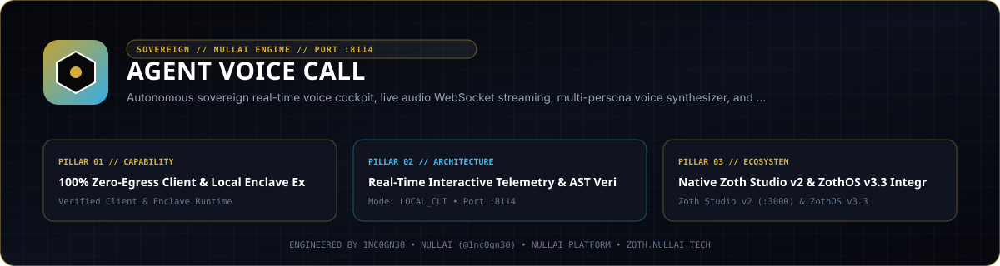

# Agent Voice Call Station



**Agent Voice Call** (`agent-voice-call`) is a zero-dependency Python 3.9+ full-duplex voice calling workstation and HTTP server (`127.0.0.1:8114`) for conversational sessions with local AI agents. It pairs a Web Audio / Web Speech browser cockpit with a 3-tier speech synthesis pipeline, token-scoped call sessions, and post-call debrief ingestion into Neuro-Memory (`:8094`), Flight Recorder (`:8104`), and optional Signal/SimpleX channels.

- **Zoth Studio v2 Dossier**: [https://zoth.nullai.tech/tools/agent-voice-call](https://zoth.nullai.tech/tools/agent-voice-call)
- **Repository**: [https://github.com/1nc0gn30/agent-voice-call](https://github.com/1nc0gn30/agent-voice-call)
- **Default Loopback Endpoint**: `http://127.0.0.1:8114`

---

## Overview

`agent-voice-call` provides voice interaction without external Python package dependencies:

- **3-Tier Speech Synthesis Pipeline (`tts_bridge.py`)**:
  1. **Tier 1 — Edge-TTS + FFmpeg**: Neural speech converted to 24 kHz mono 16-bit PCM WAV (`pcm_s16le`).
  2. **Tier 2 — Kokoro Voice Server (`127.0.0.1:9394/speak`)**: Local neural TTS server when active.
  3. **Tier 3 — `espeak-ng` / `espeak`**: Offline local speech synthesizer fallback.
- **Six Voice Personas**: `azoth`, `ghostbyte`, `athena`, `mercury`, `kitsune`, and `chronos`.
- **Echo-Guarded Web Cockpit (`/call`)**: Browser Web Speech API recognition with 8-second silence auto-send, Enter-to-send text input, Web Audio API `decodeAudioData` playback, and frequency-reactive 60 fps canvas visualization.
- **Session & Debrief Engine (`call_engine.py`)**: Single-use `secrets.token_urlsafe(16)` call tokens (2-hour TTL), local Ollama (`127.0.0.1:11434/api/generate`) dialogue routing with deterministic local fallback, and structured session transcripts on `/api/call/end`.

---

## Architecture

```text
Browser / Mobile Client (/call)
   │  Web Speech API + Web Audio API
   ▼
VoiceCallServer (127.0.0.1:8114)
   ├── CallManager (session tokens, turn history, Ollama :11434 dialogue)
   ├── tts_bridge (Edge-TTS -> Kokoro :9394 -> espeak-ng PCM WAV / Opus OGG)
   └── Post-Call Debrief -> Neuro-Memory (:8094) + Flight Recorder (:8104)
```

### Environment Configuration

| Variable | Default | Purpose |
| :--- | :--- | :--- |
| `ZOTH_BIND_HOST` | `127.0.0.1` | Default bind interface IP when `--host` is omitted |
| `ZOTH_TAILSCALE_IP` | `127.0.0.1` | Tailnet IPv4 (e.g., `100.64.0.10` or `<tailscale-ip>`) used in fallback call URLs |
| `ZOTH_TAILSCALE_DOMAIN` | `zothos.local` | HTTPS hostname emitted in `/api/call/create` for mobile microphone permissions |
| `KOKORO_PORT` | `9394` | Local Kokoro TTS daemon port |
| `EDGE_TTS_BIN` | `/opt/zothos-ai-env/bin/edge-tts` | Path to `edge-tts` binary (falls back to `PATH` lookup) |
| `SIGNAL_ACCOUNT` | *(empty)* | Optional Signal recipient identifier for UNIX socket `/tmp/signal-cli.sock` debriefs |

---

## Quickstart

```bash
git clone https://github.com/1nc0gn30/agent-voice-call.git
cd agent-voice-call
python3 -m pip install -e .

# Start the HTTP workstation on 127.0.0.1:8114
agent-voice-call serve --host 127.0.0.1 --port 8114
```

You can also run directly from source without editable installation:

```bash
python3 server.py serve --port 8114
```

Open `http://127.0.0.1:8114/call` in a Chromium or WebKit browser.

---

## CLI & ZothOS v3.4.0 Integration

On ZothOS v3.4.0, `agent-voice-call` is exposed as a system CLI wrapper:

```bash
# Inspect daemon health and available voices
agent-voice-call --status
agent-voice-call --json

# Subcommand status check
agent-voice-call status --port 8114 --json

# Generate a scoped live call session link
agent-voice-call call --channel web --voice azoth --port 8114
```

---

## REST API Reference

Mutating `POST` routes enforce local-origin CSRF validation (`127.0.0.1`, `localhost`, `[::1]`, or omitting `Origin` for local CLI requests).

| Method | Endpoint | Description |
| :--- | :--- | :--- |
| `GET` | `/`, `/call` | Serve the browser voice call cockpit (`public/index.html`) |
| `GET` | `/health`, `/status`, `/api/stats` | Daemon health, active session count, `kokoro_online`, and voice IDs |
| `GET` | `/api/voices` | Full voice persona map (`id`, `edge_voice`, `label`, `tone`) |
| `GET` | `/api/call/session?token=<tok>` | Validate or auto-provision an active web call session |
| `GET` | `/api/call/welcome?voice=azoth` | Synthesize a base64 PCM WAV greeting for speaker verification |
| `POST` | `/api/call/create` | Create a session token (`{"channel": "signal", "voice": "azoth"}`) |
| `POST` | `/api/call/speak` | Submit user utterance (`{"token": "...", "text": "...", "voice": "azoth"}`) and receive `reply_text` + `audio_base64` |
| `POST` | `/api/call/end` | Terminate session (`{"token": "..."}`) and return structured transcript summary |

---

## Testing & Verification

```bash
PYTHONPATH=src python3 -m pytest -q
./bin/agent-voice-call --help
./bin/agent-voice-call --json
```

---

## Support & License

100% free and open-source software under the MIT License. No paywalls, feature gates, or telemetry tracking.

- Optional support: [Buy Us a Coffee via Stripe](https://buy.stripe.com/3cIfZg27PdKo2D64Ocfw40X)
- Engineered by **1nc0gn30** (`@1nc0gn30`, [https://1nc0gn30.si](https://1nc0gn30.si)) • **NullAI** ([https://nullai.tech](https://nullai.tech))
